# Skywars Duel Maps

12 big floating-island maps for 1v1 Skywars, ready to paste with FAWE or WorldEdit.

- **Big:** each map is about 339–361 blocks wide, 179–271 deep and 93–157 tall (212k–437k blocks), each with a big centrepiece and fully decorated islands.
- **Fair:** every map is point-symmetric (rotated 180° around its centre), so both players get the same islands, chests and distances.
- **Empty chests:** each chest is placed as a block entity with no items, so your Skywars plugin's loot tables fill them.
- **Corner stones:** each map has a stone block at its bottom corner (**pos1**) and one at the opposite top corner (**pos2**), so you can reselect and `//copy` the exact arena after pasting.
- **Two formats:** `.schem` for 1.13+ and `.schematic` for 1.8–1.12.

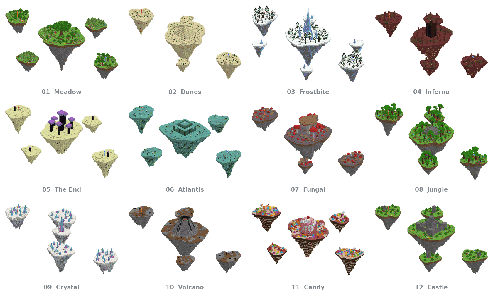

## Maps

<table>
<tr>
<td width="50%" valign="top">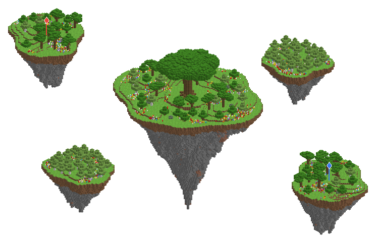<br><b>01 · Meadow</b> &nbsp;<code>01-meadow</code><br>Grassy oak islands with a giant oak tree in the middle.<br><sub>345×131×261 · 319,183 blocks · 14 chests (spawn P1 3, spawn P2 3, middle 4, side 1 2, side 2 2)</sub></td>
<td width="50%" valign="top">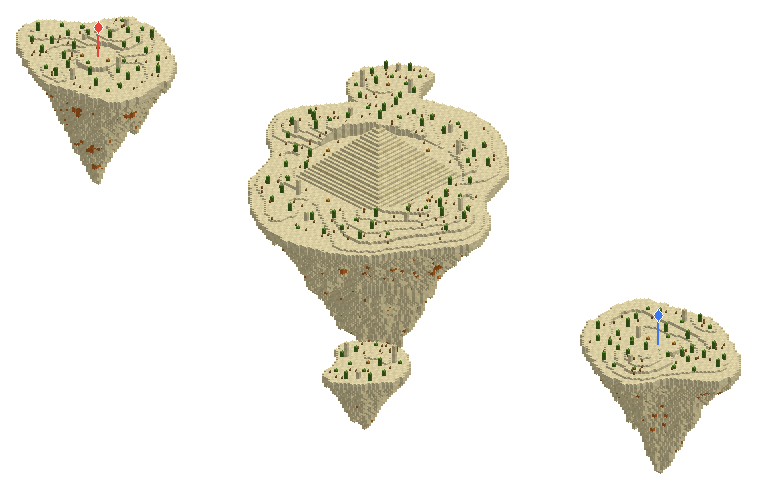<br><b>02 · Dunes</b> &nbsp;<code>02-dunes</code><br>Sandstone desert islands around a big stepped pyramid.<br><sub>357×109×185 · 314,097 blocks · 12 chests (spawn P1 3, spawn P2 3, middle 4, rock 1 1, rock 2 1)</sub></td>
</tr>
<tr>
<td width="50%" valign="top">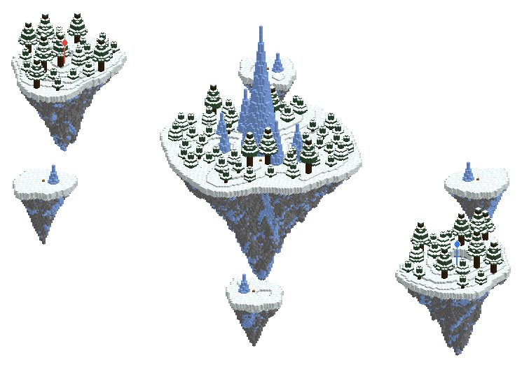<br><b>03 · Frostbite</b> &nbsp;<code>03-frostbite</code><br>Snowy spruce forests and a towering packed-ice spike.<br><sub>343×157×199 · 293,865 blocks · 14 chests (spawn P1 3, spawn P2 3, middle 4, rock 1 1, rock 2 1, rock 3 1, rock 4 1)</sub></td>
<td width="50%" valign="top">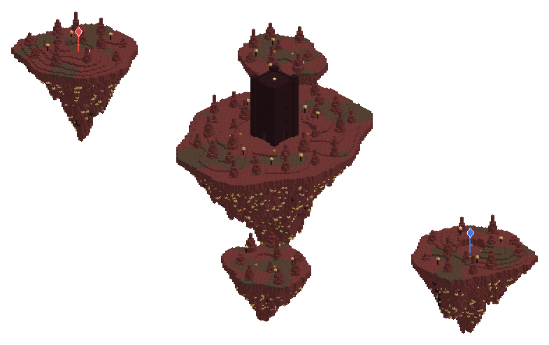<br><b>04 · Inferno</b> &nbsp;<code>04-inferno</code><br>Netherrack and soul sand around a tall nether-brick tower.<br><sub>347×112×201 · 302,093 blocks · 16 chests (spawn P1 3, spawn P2 3, middle 6, side 1 2, side 2 2)</sub></td>
</tr>
<tr>
<td width="50%" valign="top">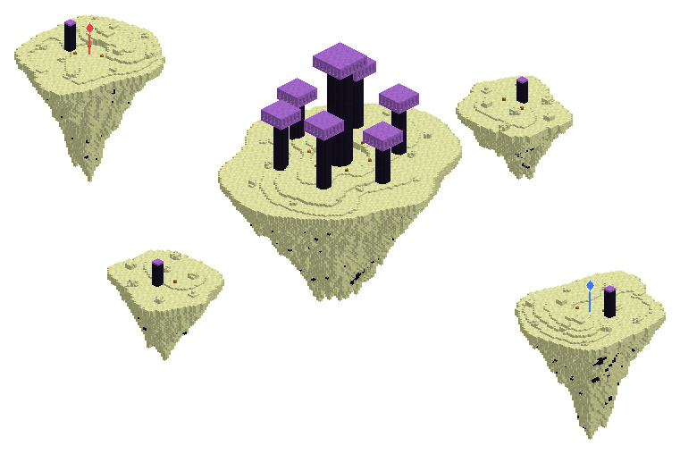<br><b>05 · The End</b> &nbsp;<code>05-the-end</code><br>End stone islands with obsidian pillars capped by purple glass cages.<br><sub>339×122×243 · 295,770 blocks · 16 chests (spawn P1 3, spawn P2 3, middle 6, side 1 2, side 2 2)</sub></td>
<td width="50%" valign="top">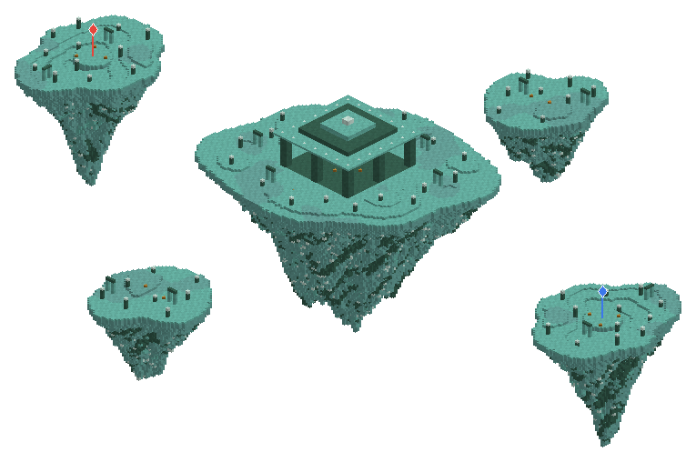<br><b>06 · Atlantis</b> &nbsp;<code>06-atlantis</code><br>Prismarine islands with sea lanterns and a huge pillared temple.<br><sub>341×98×271 · 327,708 blocks · 16 chests (spawn P1 3, spawn P2 3, middle 6, side 1 2, side 2 2)</sub></td>
</tr>
<tr>
<td width="50%" valign="top">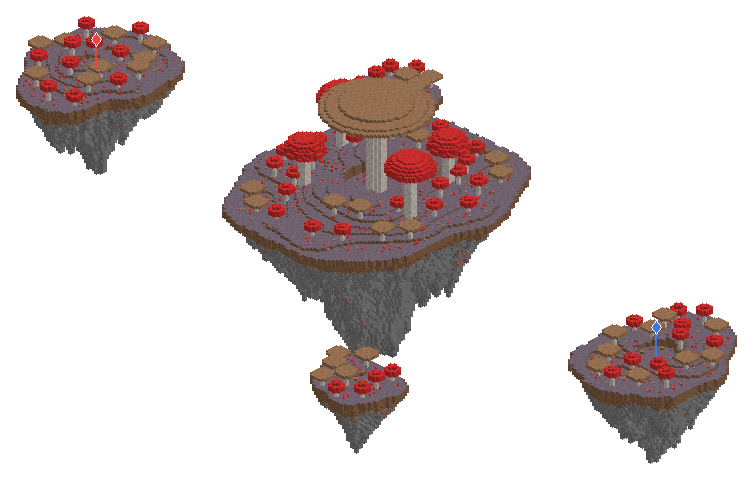<br><b>07 · Fungal</b> &nbsp;<code>07-fungal</code><br>Mycelium islands under giant red and brown mushrooms.<br><sub>341×110×189 · 301,598 blocks · 12 chests (spawn P1 3, spawn P2 3, middle 4, rock 1 1, rock 2 1)</sub></td>
<td width="50%" valign="top">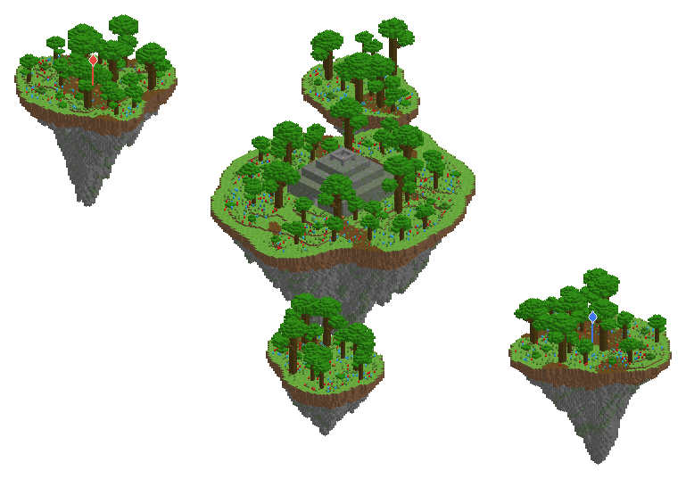<br><b>08 · Jungle</b> &nbsp;<code>08-jungle</code><br>Dense jungle with giant trees around a mossy stone temple.<br><sub>353×99×217 · 351,451 blocks · 16 chests (spawn P1 3, spawn P2 3, middle 6, side 1 2, side 2 2)</sub></td>
</tr>
<tr>
<td width="50%" valign="top">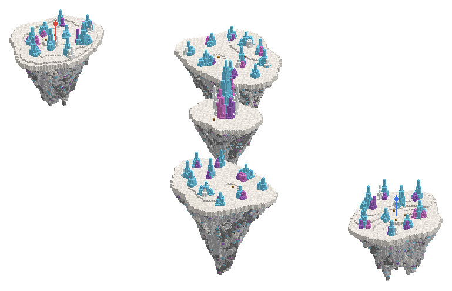<br><b>09 · Crystal</b> &nbsp;<code>09-crystal</code><br>White quartz islands with glass crystal spires and crystal drips.<br><sub>353×111×179 · 212,437 blocks · 12 chests (spawn P1 3, spawn P2 3, middle 2, twin 1 2, twin 2 2)</sub></td>
<td width="50%" valign="top">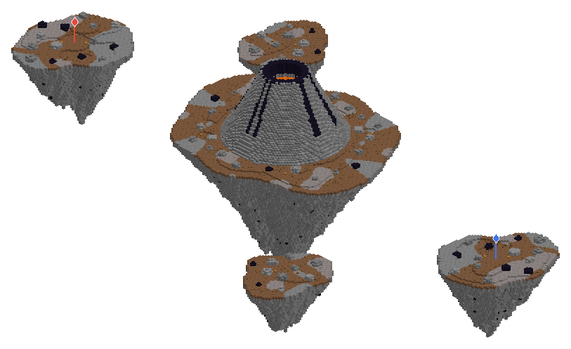<br><b>10 · Volcano</b> &nbsp;<code>10-volcano</code><br>Rocky islands around a huge volcano with a sealed lava lake.<br><sub>361×120×221 · 437,532 blocks · 14 chests (spawn P1 3, spawn P2 3, middle 4, side 1 2, side 2 2)</sub></td>
</tr>
<tr>
<td width="50%" valign="top">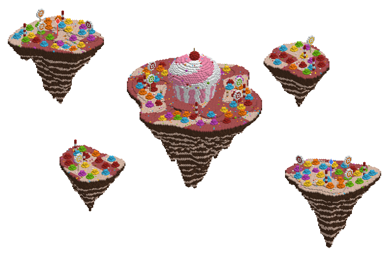<br><b>11 · Candy</b> &nbsp;<code>11-candy</code><br>Frosted islands with lollipops, candy canes and a giant cupcake.<br><sub>343×123×263 · 351,283 blocks · 14 chests (spawn P1 3, spawn P2 3, middle 4, side 1 2, side 2 2)</sub></td>
<td width="50%" valign="top">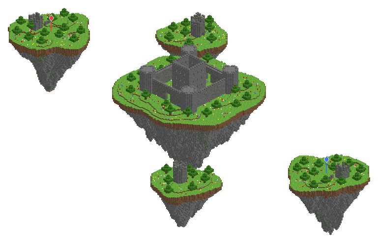<br><b>12 · Castle</b> &nbsp;<code>12-castle</code><br>Floating stone-brick ruins around a walled castle with a central keep.<br><sub>345×93×207 · 335,207 blocks · 16 chests (spawn P1 3, spawn P2 3, middle 6, side 1 2, side 2 2)</sub></td>
</tr>
</table>

## Files

| Folder | Format | Use it on |
|---|---|---|
| `schem/` | Sponge schematic v2, DataVersion 1631 (1.13.2) | FAWE / WorldEdit 7 on 1.13 → 1.21+ (blocks upgrade automatically) |
| `schematic/` | MCEdit / legacy `.schematic` | FAWE or WorldEdit 6 on 1.8–1.12 (modern WorldEdit can load these too) |
| `previews/` | PNG renders | The pictures in this README |
| `maps.json` | JSON | Size, corner stones, spawns and every chest position for each map |
| `generator/` | Python | The script that builds all of the above |

Both folders hold the same 12 maps, block for block. Only blocks that exist in 1.8 are used.

## Paste a map

1. Copy the files into `plugins/FastAsyncWorldEdit/schematics/` (or `plugins/WorldEdit/schematics/`).
2. Stand where you want the **middle** of the map, in a void world.
3. Run:

```
//schem load 01-meadow
//paste -a
```

The paste is centred on you horizontally, and the bottom layer (with the pos1 stone) is at your feet. The islands start 2 blocks above it. `-a` skips air, so nothing around the map is erased.

Each map is a few hundred thousand blocks. FAWE handles that quickly; plain WorldEdit is much slower at this size.

**Build height:** the tallest map is 157 blocks. On 1.8–1.17 (top of the world at y=255), stand at or below the y in the "Paste at y ≤" column. On 1.18+ any height up to y=160 works.

## Copy it again with the corner stones

The two stones mark opposite corners of the map's bounding box:

- **pos1 stone:** bottom, north-west corner (lowest X, Y and Z)
- **pos2 stone:** top, south-east corner (highest X, Y and Z)

```
//hpos1      (while looking at the bottom stone, or left-click it with the wand)
//hpos2      (while looking at the top stone, or right-click it with the wand)
//copy
```

The stones are far apart on maps this size, so fly to each one before targeting it. Break the two stones by hand if you don't want them in your arena. Don't use `//replace stone air`, because the islands contain stone too.

## Spawns and chests

Coordinates are relative to the **pos1 stone** (add them to the pos1 stone's world position). Each spawn is the block a player stands in, on a flat pad with a clear 3×3, 4-high space above it, so a spawn cage fits. Every chest's position is listed in [`maps.json`](maps.json).

| # | Map | Size (X×Y×Z) | pos2 stone | P1 spawn | P2 spawn | Chests | Paste at y ≤ (1.8–1.17) |
|---|---|---|---|---|---|---|---|
| 01 | Meadow | 345×131×261 | `344 130 260` | `30 86 128` | `314 86 132` | 14 | 125 |
| 02 | Dunes | 357×109×185 | `356 108 184` | `36 75 90` | `320 75 94` | 12 | 147 |
| 03 | Frostbite | 343×157×199 | `342 156 198` | `29 73 97` | `313 73 101` | 14 | 99 |
| 04 | Inferno | 347×112×201 | `346 111 200` | `31 65 98` | `315 65 102` | 16 | 144 |
| 05 | The End | 339×122×243 | `338 121 242` | `27 61 119` | `311 61 123` | 16 | 134 |
| 06 | Atlantis | 341×98×271 | `340 97 270` | `28 65 133` | `312 65 137` | 16 | 158 |
| 07 | Fungal | 341×110×189 | `340 109 188` | `28 62 92` | `312 62 96` | 12 | 146 |
| 08 | Jungle | 353×99×217 | `352 98 216` | `34 62 106` | `318 62 110` | 16 | 157 |
| 09 | Crystal | 353×111×179 | `352 110 178` | `29 61 87` | `323 61 91` | 12 | 145 |
| 10 | Volcano | 361×120×221 | `360 119 220` | `28 71 108` | `332 71 112` | 14 | 136 |
| 11 | Candy | 343×123×263 | `342 122 262` | `29 72 129` | `313 72 133` | 14 | 133 |
| 12 | Castle | 345×93×207 | `344 92 206` | `30 56 101` | `314 56 105` | 16 | 163 |

## Notes

- The gap between each spawn island and the next island is about 55–75 blocks, so expect long bridges.
- Leaves are set to persistent (no decay), and sand and gravel always rest on solid blocks.
- No valuable resources: there are no iron, gold, diamond or emerald ores or blocks. Inferno's netherrack has some nether quartz ore mixed in for looks.
- Volcano has a lava lake sealed inside its crater. No other map has liquids.

## Rebuild or change the maps

```
pip install -r generator/requirements.txt
python3 generator/build.py      # writes schem/, schematic/, previews/, maps.json
python3 generator/overview.py   # writes previews/overview.png
python3 generator/readme.py     # writes this README from maps.json
```

Each map is a function in `generator/maps.py` with its own seed and theme. `S` at the top of that file scales the island layout (sizes, depths and gaps); the centrepieces are sized for the default `S = 5`, and trees and plants stay normal size. The build checks every map for symmetry, chest placement (no double chests, nothing solid on top), safe spawns and unsupported sand or gravel.
